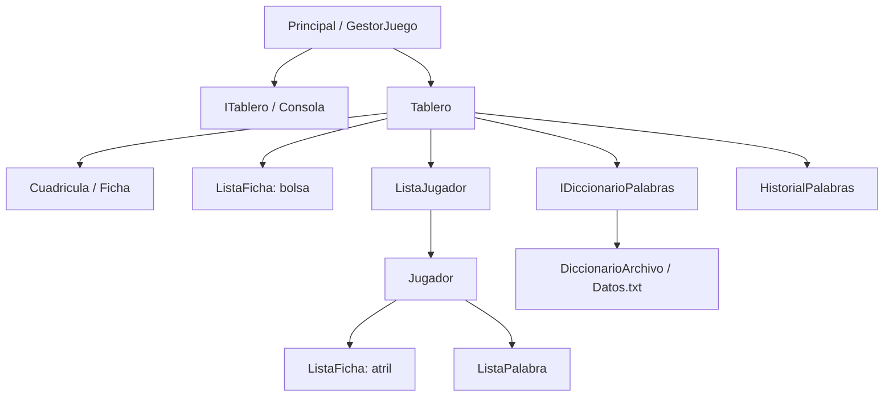
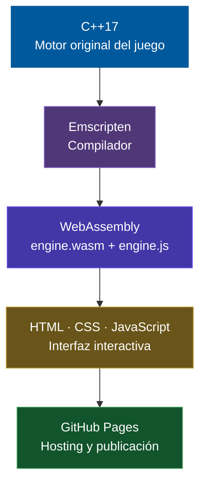
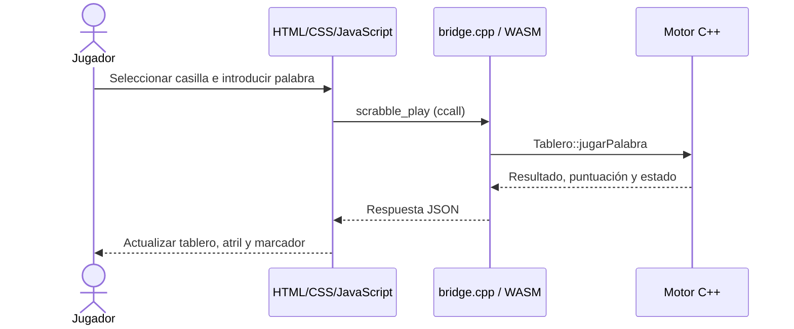
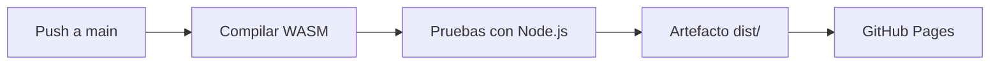

<div align="center">

# SCRABBLE · C++17 & WebAssembly

**Juego multijugador de palabras | Estructuras de datos · Ingeniería de software**


[](https://github.com/AndreaCarrilloOp/SCRABBLE/actions/workflows/ci.yml)
[](https://github.com/AndreaCarrilloOp/SCRABBLE/actions/workflows/pages.yml)

[**Jugar en el navegador**](https://andreacarrilloop.github.io/SCRABBLE/) · [Motor original](#1-motor-original-en-c) · [Web Edition](#2-web-edition-con-webassembly)

</div>

Implementación académica de un juego de palabras para consola, adaptada posteriormente al navegador. Ambas versiones comparten el motor de reglas en C++17, conservando las estructuras de datos originales. Las partidas son locales, de 2 a 4 jugadores.

## Estructura del repositorio

```text
SCRABBLE/
├── include/                 # Clases y contratos C++
├── src/                     # Motor y consola
├── test/                    # Pruebas nativas
├── web/
│   ├── bridge.cpp           # Adaptador C++ para el navegador
│   ├── build.sh             # Compilación Emscripten
│   ├── index.html           # Interfaz de usuario
│   ├── styles.css           # Tablero y diseño adaptable
│   ├── app.js               # Interacción con el motor WASM
│   └── smoke.cjs            # Pruebas del módulo compilado
├── .github/workflows/
│   ├── ci.yml               # Compilación y pruebas nativas
│   └── pages.yml            # Compilación WASM y publicación
├── Datos.txt                # Diccionario compartido
├── CMakeLists.txt           # Build nativo y CTest
├── SCRABBLE.sln             # Solución Visual Studio
├── SCRABBLE.vcxproj         # Proyecto Visual Studio
├── compilar.bat             # Script de compilación Windows
└── README.md
```

## 1. Motor original en C++

### Descripción

SCRABBLE es una implementación en **C++17** del juego de palabras para consola. Permite partidas de **2 a 4 jugadores** sobre un tablero de **15 × 15**, con atriles de seis fichas, validación mediante un diccionario local, cálculo de puntuaciones, bonificaciones del tablero e historial de jugadas.

El proyecto aplica programación orientada a objetos, estructuras enlazadas personalizadas, manejo de archivos, validación de entradas y pruebas automatizadas.

### Características principales

- Partidas para **2 a 4 jugadores**.
- Tablero clásico de **15 × 15 casillas** con cuadrícula verde y casillas de bonificación a color.
- Atril de **6 fichas por jugador**.
- Selección aleatoria del jugador inicial.
- Colocación horizontal o vertical de palabras.
- Validación de palabras mediante `Datos.txt`.
- Comprobación de límites, conexiones y letras superpuestas.
- Validación de las palabras cruzadas generadas por una jugada.
- Cálculo de puntos y aplicación de bonificaciones.
- Intercambio de fichas con la bolsa.
- Historial de palabras aceptadas.
- Control de pases consecutivos y finalización de la partida.
- Clasificación final de participantes por puntaje.
- Manejo seguro de entradas inválidas en consola.
- Pruebas automatizadas integradas con **CTest**.

### Arquitectura y construcción del motor



| Componente | Responsabilidad |
|---|---|
| `Principal`, `GestorJuego` | Inicialización y coordinación de turnos en consola |
| `ITablero`, `Consola` | Entrada, presentación y configuración de terminal |
| `Tablero`, `Cuadricula` | Estado del tablero, validación, bonificaciones y puntuación |
| `Jugador`, `Ficha`, `Palabra` | Entidades del dominio |
| `ListaFicha`, `ListaJugador`, `ListaPalabra` | Colecciones enlazadas personalizadas |
| `IDiccionarioPalabras`, `DiccionarioArchivo`, `ValidadorPalabras` | Contrato y componentes de validación léxica |
| `HistorialPalabras` | Registro de jugadas aceptadas |

### Estructuras de datos y algoritmos

| Estructura | Aplicación | Complejidad relevante |
|---|---|---|
| Matriz `Cuadricula* tabla[15][15]` | 225 casillas con fichas y multiplicadores | Acceso por coordenadas O(1) |
| Lista simplemente enlazada `ListaFicha` | Bolsa y atril; punteros a cabeza y cola | Inserción al final O(1); búsqueda y extracción por índice O(n) |
| Lista simplemente enlazada `ListaJugador` | Participantes y clasificación | Acceso por índice O(n); ordenamiento O(n log n) |
| Lista simplemente enlazada `ListaPalabra` | Palabras registradas por cada jugador | Búsqueda O(n) |
| `std::unordered_set<std::string>` | Diccionario en memoria | Consulta promedio O(1) respecto al número de palabras |
| `std::vector<std::string>` | Historial global | Inserción al final O(1) amortizado |

Las complejidades son análisis teóricos, no mediciones. La normalización y el hash del diccionario dependen también de la longitud de la palabra.

- **Merge sort:** ordena la lista de jugadores por puntaje en la clasificación de consola.
- **Barajado:** copia los punteros de las fichas a un vector, aplica `std::shuffle` y reasigna los valores de los nodos en O(n), con espacio auxiliar O(n).
- **Validación:** comprueba coordenadas, orientación, conexión, fichas y palabras principal y cruzadas antes de modificar el tablero.
- **Puntuación:** contabiliza las letras existentes y nuevas; los multiplicadores solo se aplican a fichas nuevas.

El motor conserva la programación orientada a objetos, la gestión de memoria de las listas y la separación entre reglas y presentación.

### Flujo de una partida

1. El sistema carga el diccionario desde `Datos.txt`.
2. Se registra la cantidad de participantes y sus nombres.
3. Se llena la bolsa y se reparten seis fichas a cada jugador.
4. Se selecciona aleatoriamente al jugador inicial.
5. En cada turno, el participante puede:
   - Jugar una palabra.
   - Cambiar fichas.
   - Consultar el historial.
   - Pasar el turno.
   - Finalizar la partida.
6. Al terminar, el sistema aplica los ajustes correspondientes y muestra la clasificación final.

### Reglas implementadas

- Las palabras deben contener entre **2 y 6 letras**.
- Todas las palabras deben existir en `Datos.txt`.
- La primera palabra debe cruzar la casilla central `(7,7)`.
- Las jugadas posteriores deben conectarse con fichas existentes.
- Las letras colocadas sobre fichas existentes deben coincidir.
- La palabra debe caber completamente dentro del tablero.
- Las palabras cruzadas creadas por una jugada también deben ser válidas.
- Las bonificaciones de letra y palabra se aplican únicamente a fichas nuevas.
- Las fichas utilizadas se retiran del atril y se reponen desde la bolsa.
- Una jugada inválida no consume el turno.
- La partida puede finalizar cuando:
  - Se acumulan dos rondas completas de pases consecutivos.
  - La bolsa queda vacía y un jugador se queda sin fichas.
  - Los participantes deciden terminarla manualmente.

### Diccionario de palabras

El archivo `Datos.txt` contiene las palabras admitidas por el juego. Debe permanecer junto al ejecutable o en una de las rutas de búsqueda previstas por la aplicación.

Para ampliar el diccionario, agregue una palabra por línea respetando las reglas del proyecto. Se recomienda utilizar letras sin espacios ni caracteres especiales.

### Compilación nativa y pruebas

La edición de consola utiliza C++17, la biblioteca estándar, CMake 3.16+ y CTest. No requiere Emscripten, Node.js ni bibliotecas externas de C++.

#### Requisitos

##### Opción 1: Visual Studio

- Windows 10 u 11.
- Visual Studio 2022 o posterior.
- Componente **Desarrollo para el escritorio con C++**.
- Herramientas MSVC compatibles con C++17; seleccione el toolset instalado al redestinar la solución.

##### Opción 2: CMake

- Compilador compatible con C++17, por ejemplo:
  - Microsoft Visual C++.
  - GCC.
  - Clang.
- CMake 3.16 o superior.

#### Compilar con Visual Studio

1. Abra `SCRABBLE.sln`.
2. Seleccione la plataforma `x64`.
3. Seleccione la configuración `Debug` o `Release`.
4. Ejecute **Build > Build Solution**.
5. Inicie el proyecto desde Visual Studio.

El archivo `Datos.txt` se copia automáticamente junto al ejecutable.

> [!NOTE]
> La compilación mediante CMake es la alternativa recomendada mientras se revisa la configuración de la solución nativa. Si aparece `MSB8020`, redestine la solución a un toolset instalado (por ejemplo, `v143` para Visual Studio 2022). Cierre los ejecutables antiguos y use **Build > Clean Solution** y **Build > Rebuild Solution**.

#### Compilar con CMake

Desde la carpeta raíz del proyecto:

```bash
cmake -S . -B build
cmake --build build --config Release
```

##### Ejecutar en Windows

```powershell
.\build\Release\SCRABBLE.exe
```

Según el generador utilizado, el ejecutable también podría encontrarse directamente en `build`.

##### Ejecutar en Linux

```bash
./build/SCRABBLE
```

#### Vista previa del tablero

En terminales compatibles con secuencias ANSI se muestran las coordenadas de 0 a 14 y las casillas de bonificación:

| Color | Bonificación |
|---|---|
| Rojo | Triple palabra |
| Magenta | Doble palabra |
| Azul | Triple letra |
| Celeste | Doble letra |
| Amarillo | Centro (doble palabra) |

Cada casilla ocupa cinco caracteres de ancho. Se recomienda una terminal de al menos 100 columnas para evitar saltos de línea.

Las fichas colocadas tienen un fondo claro. Una consola sin soporte de color o con la variable `NO_COLOR` conserva los códigos de bonificación en texto.

Vista previa sin iniciar una partida:

```powershell
.\build\Release\SCRABBLE.exe --preview
```

```bash
./build/SCRABBLE --preview
```

Use `--preview-plain` para forzar texto o `--preview-color` para generar explícitamente la salida ANSI.

#### Compilar automáticamente en Windows

También puede utilizar el script incluido:

```bat
compilar.bat
```

Este script configura el proyecto, compila la solución y ejecuta las pruebas.

#### Ejecutar las pruebas

```bash
cmake -S . -B build
cmake --build build --config Release
ctest --test-dir build -C Release --output-on-failure
```

Las pruebas incluidas verifican jugadas válidas e inválidas, puntuación de palabras extendidas, intercambio de fichas, integridad de la lista enlazada y la distribución de las bonificaciones. Las comprobaciones se ejecutan también en compilaciones Release.

## 2. Web Edition con WebAssembly

**[Abrir aplicación web](https://andreacarrilloop.github.io/SCRABBLE/)**

La edición web reutiliza la lógica de C++ sin traducir las reglas a JavaScript. Emscripten compila las fuentes del motor y un adaptador a WebAssembly; HTML, CSS y JavaScript proporcionan la interfaz interactiva. No se necesita un servidor de partidas.

### Arquitectura de implementación



El diagrama representa la cadena de construcción e integración. Durante la ejecución, la comunicación entre la interfaz y el motor es bidireccional:



### Responsabilidades y contrato

| Componente | Función |
|---|---|
| [`web/bridge.cpp`](web/bridge.cpp) | Gestiona una sesión local, invoca el motor y serializa el estado |
| [`web/build.sh`](web/build.sh) | Compila C++17 con Emscripten; integra `Datos.txt` en el sistema de archivos virtual |
| [`web/index.html`](web/index.html) | Estructura semántica y controles |
| [`web/styles.css`](web/styles.css) | Cuadrícula verde, casillas rectangulares, colores y diseño adaptable |
| [`web/app.js`](web/app.js) | Eventos, selección de coordenadas, renderizado y llamadas al módulo mediante `ccall` |
| [`web/smoke.cjs`](web/smoke.cjs) | Verificación automática del motor WASM con Node.js |

El adaptador exporta seis operaciones: `scrabble_state`, `scrabble_start`, `scrabble_play`, `scrabble_exchange`, `scrabble_pass` y `scrabble_finish`. Las respuestas JSON incluyen el resultado, el mensaje, el estado del tablero, jugadores, atril activo, bolsa e historial.

### Compilación web y pruebas

Con Emscripten SDK activado, Node.js y Python 3 disponibles, ejecute desde la raíz en Bash (Linux o WSL):

```bash
bash web/build.sh
node web/smoke.cjs
python3 -m http.server 8000 --directory dist
```

Abra `http://localhost:8000`. Los archivos generados `engine.js` y `engine.wasm`, junto con la interfaz, se guardan en `dist/`. No es necesario compilar la solución de Visual Studio para ejecutar la edición web.

Las pruebas WASM verifican la distribución de las 225 casillas, el inicio de una partida, jugadas rechazadas sin alterar el estado, intercambio, pases, finalización y reinicio. No sustituyen las pruebas del motor nativo ni las pruebas manuales del navegador.

### CI/CD y despliegue



El workflow [`pages.yml`](.github/workflows/pages.yml) instala Emscripten 3.1.74, compila el motor, ejecuta las pruebas y publica el artefacto si se ejecuta desde `main`. En **Settings → Pages**, la fuente de publicación es **GitHub Actions**.

### Independencia de las compilaciones

| Edición nativa | Edición web |
|---|---|
| `src/Principal.cpp` y `GestorJuego` | `web/bridge.cpp` |
| CMake / MSBuild | Emscripten |
| Ejecutable local | `engine.js` + `engine.wasm` |
| `build/` | `dist/` |
| CTest | Node.js smoke tests |
| `ci.yml` | `pages.yml` |

No se sustituye el punto de entrada de consola ni se añaden dependencias web a CMake. Las dos ediciones reutilizan las fuentes comunes del motor y mantienen sus propias rutas de compilación.

## Uso académico

Proyecto de Estructuras de Datos que integra programación orientada a objetos, colecciones enlazadas, algoritmos, validación, gestión de archivos, pruebas y construcción multiplataforma.

